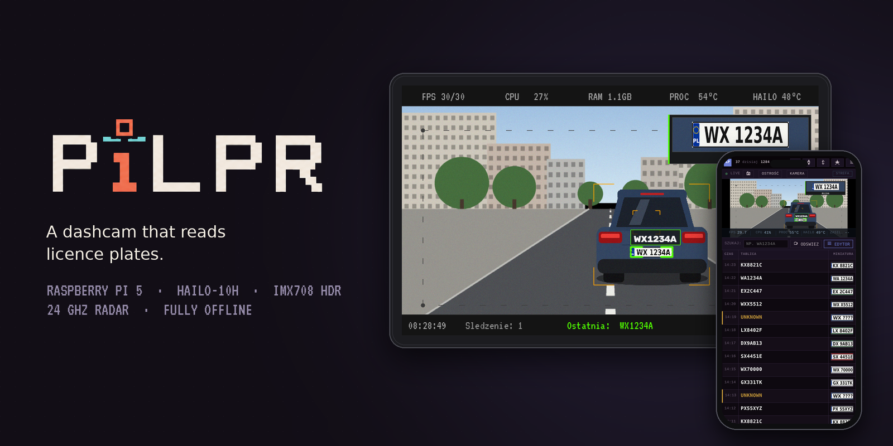

<p align="center">
  
</p>

<p align="center">
  <a href="README.pl.md">Polska wersja</a> &nbsp;·&nbsp;
  <a href="#what-it-does">Features</a> &nbsp;·&nbsp;
  <a href="#how-it-works">How it works</a> &nbsp;·&nbsp;
  <a href="#hardware">Hardware</a> &nbsp;·&nbsp;
  <a href="#running-it">Running it</a>
</p>

PiCamera, which calls itself PiLPR on its own screen, began with a small idea. A camera behind the windscreen reads the plates of passing cars, and when you drive past friends or family it tells you, so you can give them a call. It grew from there into a complete in-car system that I have been building and driving with for months.

It records like any dashcam. It reads plates in real time on a Hailo-10H accelerator and checks them against lists you keep yourself. It speaks to you through the car's Bluetooth audio. With a small 24 GHz radar at the front it measures the speed of passing cars and takes a speed-camera style photo of anyone over the limit, which was the reason for the last addition: people drive far too fast through my neighbourhood.

Everything runs on the Pi. There is no cloud and no account, just the touch screen in the car and a web panel on your phone.

<table>
  <tr>
    <td width="50%"></td>
    <td width="50%"></td>
  </tr>
  <tr>
    <td><b>You passed someone you know.</b> A plate from one of your lists shows up as a banner with a photo of the car, and the Pi reads the message out loud.</td>
    <td><b>Who was the fastest today.</b> In radar mode every car above the threshold gets a photo with its plate, speed, date and time, and a short video clip.</td>
  </tr>
  <tr>
    <td width="50%"></td>
    <td width="50%"></td>
  </tr>
  <tr>
    <td><b>Every plate, once.</b> The web panel shows the live view and the history of recognised plates, and lets you mark each reading as right or wrong to train the next model.</td>
    <td><b>And still a dashcam.</b> Continuous recording in one-minute segments, browsable and playable from the phone.</td>
  </tr>
</table>

<sub>All images in this README were made without real recordings or real plates; the plate numbers are invented. The device screens are drawn by the project's own rendering code on a synthetic scene, see <a href="docs/obrazy_demo">docs/obrazy_demo</a>.</sub>

## What it does

**Dashcam.** Continuous H.264 recording in 60-second segments to a USB stick, with automatic rotation when the 20 GB budget is used up. Without a stick it falls back to the SD card and moves the recordings across once a stick is plugged in again. Segments can be browsed and played from the phone.

**Licence plate recognition.** A custom-trained YOLOv8n detector (car, bus, truck, motorcycle, plate) runs on the Hailo-10H with NMS on the chip. ByteTrack follows each plate across frames. OCR runs many times per plate while it is in view, and the result is a weighted vote rather than a single guess. Every confirmed plate is saved once, with the best full frame, a close-up crop and an entry in SQLite.

**Watchlists.** Any number of named lists (for example Friends, Family, or anything you import from a CSV), each with its own colour and its own spoken message template. A hit shows a banner and a photo of the car on screen and is read out through a Piper voice. Matching is exact first, and then tolerant of the characters OCR typically confuses (0/O/D, 1/I, 5/S, 8/B), in which case the message explicitly starts with "unconfirmed".

**Unmarked police car warnings.** Next to the friends lists you can keep two lists of official vehicles: "Radiowozy nieoznakowane" (unmarked police cars) and "Pojazdy służbowe" (other official vehicles). A hit on either gives the same alert on screen and by voice. The app ships with no such list; you can import your own from a CSV file.

**Speed camera mode.** An HLK-LD2415H Doppler radar on the serial port measures speed. When a car exceeds the threshold, the system waits for its plate, checks that the plate belongs to the car the radar measured, and saves a photo with the speed, date, time and plate burnt in, plus a short clip from the dashcam with a box that follows the car.

**Review and training loop.** Each reading can be marked as correct, corrected, partial, unreadable or not a plate, from the web panel or from an offline Windows viewer that lives on the same USB stick. Those verdicts feed the training scripts for the next OCR and detection models.

## Screenshots

<p align="center">
  
  
</p>
<p align="center"><sub>The device screen while driving and in radar mode: tracked plates, the latest confirmed plate, live speed from the radar, and system stats along the top.</sub></p>

<p align="center">
  
  
</p>
<p align="center"><sub>The watchlist editor and the list of radar events in the web panel. The panel is served by the device itself and can be installed on a phone like an app.</sub></p>

## Hardware

| Part | Model | Role |
|---|---|---|
| Computer | Raspberry Pi 5, 8 GB | everything |
| AI accelerator | Hailo-10H, M.2 | plate and vehicle detection, optional OCR |
| Camera | Arducam IMX708 HDR (B0310) with a 25 mm lens, CSI | 2304×1296 at 30 fps, hardware HDR |
| Radar | HLK-LD2415H, 24 GHz CW Doppler, UART | speed only, ±1 km/h, range up to about 180 m |
| Display | small touch screen (800×480 by default, the real size is read from DRM) | live view and tile menu |
| Audio | PAM8302 amplifier on the Pi's PWM audio, or the car's head unit over Bluetooth | spoken alerts |
| Storage | USB stick | photos, database, recordings, backups |

The project started with a Kurokesu C1 PRO USB camera. That code path still exists and is selected with `"cam_source": "usb"` in the runtime config.

Printable mounts for the Pi, the camera and the front module are in [hardware/](hardware) (3MF and STL).

<p align="center">
  
</p>

## How it works

<p align="center">
  
</p>

The whole application is one systemd user service, `lpr.service`, started by `lpr_run.sh`. The main parts, in the order a frame meets them:

1. **Two streams from one sensor.** Picamera2 asks the ISP for two outputs at once. The full 2304×1296 frame goes into a one-second ring buffer in RAM. A 1280×720 copy, scaled in hardware, feeds the GStreamer pipeline. Detection on the smaller stream loses nothing measurable (checked with an A/B script against human-verified boxes), and the crop element dropped from 18.8 ms to 0.8 ms per frame. Crops for OCR and saved photos are cut from the full-resolution frame, matched by frame number.
2. **Detection and tracking** run in the hailo-apps GStreamer pipeline: `hailonet` with the custom HEF, then `hailotracker`. A Python callback receives detections for every frame.
3. **TrackManager** keeps the state of every plate in view. It ignores detections outside a configurable detection zone, skips plates cut by the edge of the frame, keeps the best frame (largest box times confidence) and decides when a track is finished: 1.5 s without a detection, or 120 s in total for long stops.
4. **OcrWorker** reads crops in the background. The default backend is fast-plate-ocr (a CCT model fine-tuned on Polish plates) on one CPU core. A Hailo backend exists as well. It runs HailoRT in a child process, because some firmware calls hold the GIL and froze the preview when they ran in the main process. There used to be a rule that forced readings into the Polish plate format. Measured against 1,362 human labels it broke about one real plate in ten, so it is switched off: the fine-tuned model already knows the format, and every hand-written rule only made it worse.
5. **Consensus.** Readings are grouped by Levenshtein distance ≤ 1. Each vote is weighted by the OCR confidence and the crop height, because measurements on 254 crops showed that reads at 60 to 120 px are right about 90% of the time and reads above or below that much less often (sharpness turned out not to matter). Before this, three weak reads from far away could outvote two confident ones from up close. A plate counts as confirmed with at least three agreeing reads, and once it is confirmed the worker keeps reading it for a while from close range.
6. **SaveWorker** writes the JPEGs atomically (temporary file, fsync, rename) and records the sighting in SQLite in WAL mode, deduplicated over 30 minutes.

Around that core there are a few things that took most of the debugging time:

- **Thread priorities.** The dashcam encoder and the recognition pipeline share four cores. A guard thread names the pipeline threads and keeps them above the encoder, so recording never starves recognition.
- **Latency measurement.** Every buffer is stamped with its frame number, so the callback knows exactly how many frames are stuck in the pipeline. This is how a 51-second backlog on one drive was traced to a specific queue.
- **Watchdog.** The drawing loop sends a `WATCHDOG=1` heartbeat to systemd, so a frozen display can be restarted by systemd (with `WatchdogSec` set on the unit). The service restarts on failure, with a limit that stops a crash loop.
- **Errors that leave a trace.** In a car the program has to keep running, so many errors are caught. Each one is still logged the first time and summarised every five minutes after that, because a silent `except: pass` once hid a real bug for ten days.
- **Storage.** The database is backed up every 30 minutes and photos incrementally. The stick can be ejected safely from the menu. Data written to the SD card while no stick was present is merged into the stick's database later by `scal_baze_sd.py`.

### Radar mode

<p align="center">
  
</p>
<p align="center"><sub>A speed-camera photo as the device saves it: vehicle and plate boxes, an enlarged plate crop, plate, date, time and speed. Rendered by the project's own code on a synthetic scene.</sub></p>

The radar knows speed but not distance, and it sees much further than a plate can be read. Joining the two is the interesting part.

- The radar sends lines like `V+058.3` up to about 22 times per second. An event opens after three samples above the threshold.
- Doppler modules produce harmonic spikes when the echo fades (a car at 50 km/h briefly reads as 101). A sample more than 1.5 times and 20 km/h above the median of the last 0.6 s is dropped. The speed stored for the event is the median of the five highest samples, not the peak.
- When the radar goes quiet for 1.5 s the event closes and the system waits up to 15 s for a plate.
- To avoid pinning the speed on the wrong car, every track also gets a **speed estimated from the camera**. Distance is proportional to the inverse of the plate's width in pixels (d = K / px, with K worked out from the lens and sensor geometry), and a linear fit of distance over time gives km/h. The candidate whose camera speed agrees with the radar wins. If none agrees, the event is saved and marked as uncertain.
- All radar samples and every camera/radar pair are also written to daily CSV files, and `analiza_kalibracji_radaru.py` uses them to recalibrate K.

<p align="center">
  
  
</p>
<p align="center"><sub>Simulated data showing how an event is processed, and how speed is estimated from the growing plate.</sub></p>

## Numbers

Measured on the device unless noted otherwise.

| | |
|---|---|
| Camera and detection | 30 fps, about 25% CPU and 1.1 GB RAM during normal operation |
| Detector on Hailo-10H | 234.6 fps in `hailortcli benchmark` |
| OCR, CPU (fast-plate-ocr CCT) | 213 of 254 test plates exactly right (83.9%) from a single read; median 117 ms per read |
| OCR, Hailo (PaddleOCR rec, INT8) | 200 of 254 (78.7%), median 9.2 ms per read |
| Dashcam | 1280×720, 15 fps, 4 Mb/s, about 30 MB per minute |

The OCR figures are for a single read on a fixed test set of 254 plates from one day of driving, kept apart from the training data. In use, a plate is read many times and the vote is more accurate than any single read. The CPU backend is the default because it is more accurate. Getting the quantised Hailo model to match its emulated accuracy (81.5% in the SDK, much lower on the chip for the best variant) is still an open problem, documented in [pi/local_resources/ocr/hailo_20261006](pi/local_resources/ocr/hailo_20261006) and [docs/ocr-hailo-wdrozenie.md](docs/ocr-hailo-wdrozenie.md).

## Repository layout

```
pi/                         everything that runs on the Raspberry Pi
  lpr.py                    the application (pipeline, OCR, radar, dashcam, UI, web panel)
  lpr_hailo_ocr.py          OCR on Hailo in a child process
  lpr_splash.py             animated boot screen, a separate light process
  lpr_run.sh, lpr.service   start script and systemd unit
  collect_plates.py         collecting detection training data while driving
  scal_baze_sd.py           merging the SD-card database into the USB stick database
  sprawdz_zdrowie.sh        post-deployment health check
  wgraj_na_malinke.sh       deploy from a PC over SSH, compile, commit on the Pi, restart, verify
  przegladarka_usb/         offline viewer for Windows (built with PyInstaller onto the stick)
  narzedzia_testowe/        test and diagnostic tools, including a local stub of the web panel
training/                   building datasets from reviewed readings, training and evaluating OCR
  hailo/                    quantisation scripts for the Hailo Dataflow Compiler
hardware/                   3D printable mounts
docs/                       images, diagrams and engineering notes
```

Code, comments and the user interface are in Polish.

## Running it

This is a working personal device rather than a packaged product, so setting it up takes some effort.

1. Install the Hailo software for the Raspberry Pi 5 and [hailo-apps](https://github.com/hailo-ai/hailo-apps) (version 26.x) in `/home/admin/hailo-apps`. PiLPR runs on top of its GStreamer pipeline classes.
2. Copy the contents of `pi/` into that directory, keeping the subfolders.
3. Put the models in `local_resources/`: the detector HEF (`lpr_yolov8n_v3`), the OCR model `ocr/cct_s_v2_pl.onnx` with its plate config, and optionally the Piper voice `tts/pl_PL-gosia-medium.onnx`. Trained weights are not part of this repository, because they were trained on private road footage.
4. Install the service: `cp lpr.service ~/.config/systemd/user/ && systemctl --user enable --now lpr`.
5. Open `http://<pi address>/` from a phone on the same network.

For the radar, enable `dtparam=uart0=on` and connect the module to GPIO14/15. Settings changed in the web panel are stored in `local_resources/lpr_runtime_config.json`. To deploy changes from a PC, set up SSH keys and run `LPR_PI_SSH=admin@raspberrypi.local bash pi/wgraj_na_malinke.sh "description"`.

The web panel has no login. Keep it on a trusted network or behind a VPN.

## Privacy and responsible use

A licence plate is personal data under the GDPR when it can be linked to a person, and this device stores plates, photos and times. If you build one:

- keep the data on the device, do not publish photos or plates of other people, and delete what you do not need,
- put only people who agreed to it on your lists,
- in lists you share with others, include only institutions' official vehicles, never the private cars of specific people (police officers included), because that is personal data,
- treat radar mode as a way to measure traffic on your own street, not as enforcement. A private speed measurement is not a legal basis for a fine, and sharing photos of identifiable drivers online can break the law on its own,
- check the rules for recording public roads and for in-car devices in your country.

No recordings, plate databases or trained models are included here, and the plate numbers in the code and images are made up.

## Status and ideas

The device has been riding in my car since April 2026. Things I would like to do next, and where help is welcome:

- split `lpr.py` (about 15,000 lines) into modules, with the web panel's HTML moved out into its own files,
- close the accuracy gap of OCR on Hailo so the CPU is free for other work,
- add a proper configuration file instead of constants and `/home/admin` paths,
- add tests for the consensus, plate format and radar event logic, which are pure functions and easy to cover,
- a separate stationary version of the radar mode for measuring traffic on a residential street.

If you want to build one, adapt it or talk about the project, open an issue.

## License

[PolyForm Noncommercial 1.0.0](LICENSE). You can use, study and modify the code for free for any noncommercial purpose: personal projects, research, education, hobby builds. Using it in a commercial product or service needs a separate license from me, so open an issue or get in touch if that is what you have in mind.
