<p align="center">
  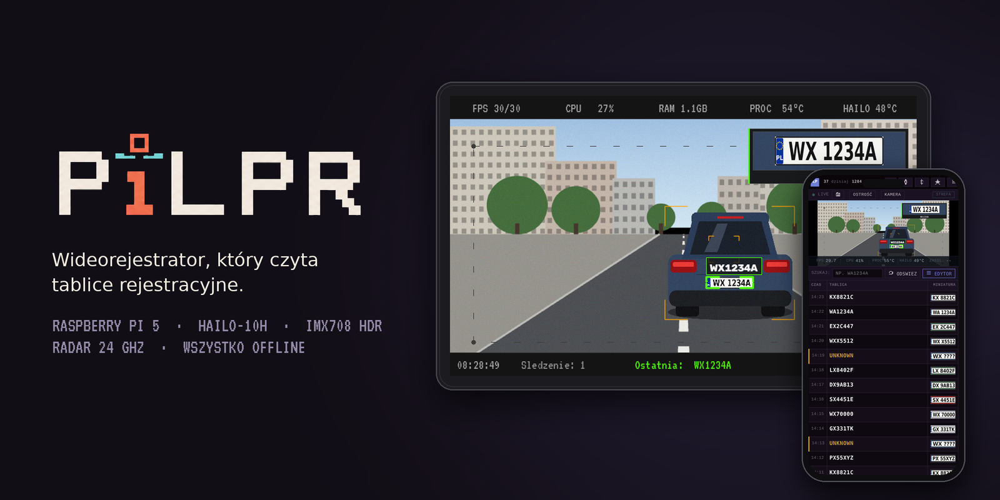
</p>

<p align="center">
  <a href="README.md">English version</a> &nbsp;·&nbsp;
  <a href="#co-potrafi">Funkcje</a> &nbsp;·&nbsp;
  <a href="#jak-to-działa">Jak to działa</a> &nbsp;·&nbsp;
  <a href="#sprzęt">Sprzęt</a> &nbsp;·&nbsp;
  <a href="#uruchomienie">Uruchomienie</a>
</p>

PiCamera, które na swoim ekranie przedstawia się jako PiLPR, zaczęło się od małego pomysłu. Kamera za szybą czyta tablice mijanych aut, a kiedy przejeżdżasz obok znajomych albo rodziny, daje ci znać, żebyś mógł do nich zadzwonić. Z tego wyrósł kompletny system do auta, który od miesięcy buduję i z którym jeżdżę.

Nagrywa jak każdy wideorejestrator. Czyta tablice w czasie rzeczywistym na akceleratorze Hailo-10H i sprawdza je z listami, które prowadzisz sam. Mówi do ciebie przez Bluetooth w samochodzie. Z małym radarem 24 GHz z przodu mierzy prędkość przejeżdżających aut i robi zdjęcie w stylu fotoradaru każdemu, kto jedzie za szybko. To ostatni dodatek i wziął się stąd, że na moim osiedlu ludzie jeżdżą o wiele za szybko.

Wszystko działa na malince. Nie ma chmury ani konta, jest ekran dotykowy w aucie i panel www w telefonie.

<table>
  <tr>
    <td width="50%">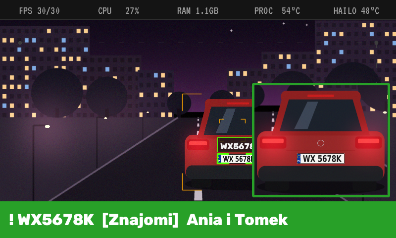</td>
    <td width="50%">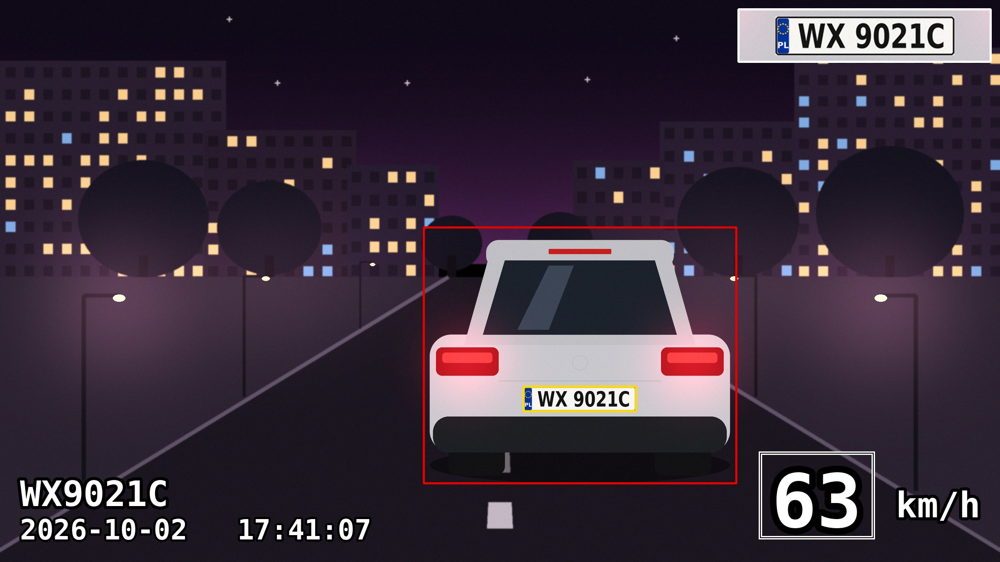</td>
  </tr>
  <tr>
    <td><b>Minąłeś kogoś znajomego.</b> Tablica z jednej z twoich list pojawia się jako baner ze zdjęciem auta, a malinka czyta komunikat na głos.</td>
    <td><b>Kto dziś jechał najszybciej.</b> W trybie radaru każde auto powyżej progu dostaje zdjęcie z tablicą, prędkością, datą i godziną oraz krótki klip wideo.</td>
  </tr>
  <tr>
    <td width="50%">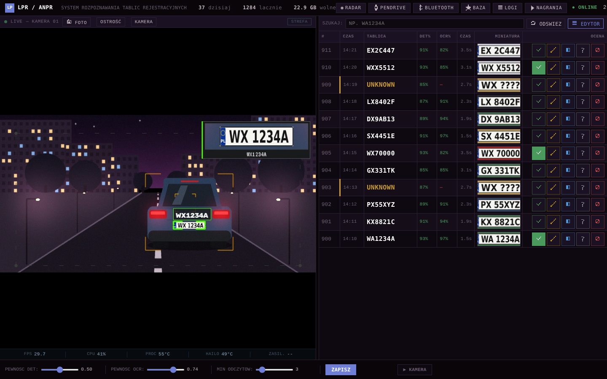</td>
    <td width="50%">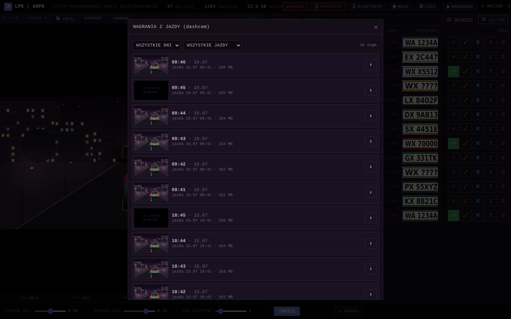</td>
  </tr>
  <tr>
    <td><b>Każda tablica raz.</b> Panel www pokazuje podgląd na żywo i historię rozpoznanych tablic, a każdy odczyt można ocenić jako dobry albo zły, żeby wytrenować kolejny model.</td>
    <td><b>I dalej wideorejestrator.</b> Ciągłe nagrywanie w minutowych segmentach, do przeglądania i odtwarzania z telefonu.</td>
  </tr>
</table>

<sub>Wszystkie obrazy w tym opisie powstały bez prawdziwych nagrań i bez prawdziwych tablic, numery są zmyślone. Ekrany urządzenia rysuje własny kod projektu na syntetycznej scenie, szczegóły w <a href="docs/obrazy_demo">docs/obrazy_demo</a>.</sub>

## Co potrafi

**Wideorejestrator.** Ciągłe nagrywanie H.264 w segmentach po 60 sekund na pendrive, z automatycznym kasowaniem najstarszych nagrań po przekroczeniu 20 GB. Bez pendrive'a nagrywa na kartę SD i przenosi nagrania, gdy pendrive wróci. Segmenty można przeglądać i odtwarzać z telefonu.

**Rozpoznawanie tablic.** Własny, wytrenowany detektor YOLOv8n (osobowe, autobusy, ciężarówki, motocykle, tablice) działa na Hailo-10H, z NMS liczonym na chipie. ByteTrack śledzi każdą tablicę przez kolejne klatki. OCR czyta tablicę wiele razy, póki jest w kadrze, a wynikiem jest ważone głosowanie, a nie jeden strzał. Każda potwierdzona tablica zapisuje się raz: najlepsza pełna klatka, powiększony wycinek i wpis w SQLite.

**Bazy obserwowanych.** Dowolna liczba nazwanych list (na przykład Znajomi, Rodzina albo cokolwiek zaimportowanego z CSV), każda z własnym kolorem i szablonem komunikatu. Trafienie to baner i zdjęcie auta na ekranie oraz komunikat czytany głosem Piper. Dopasowanie jest najpierw dokładne, a potem odporne na znaki, które OCR najczęściej myli (0/O/D, 1/I, 5/S, 8/B). W tym drugim przypadku komunikat zaczyna się wprost od słowa „niepotwierdzony”.

**Ostrzeganie przed nieoznakowanymi radiowozami.** Obok baz znajomych możesz prowadzić dwie listy pojazdów służbowych: „Radiowozy nieoznakowane” i „Pojazdy służbowe”. Trafienie z każdej z nich daje ten sam alert na ekranie i głosem. Aplikacja nie zawiera żadnej takiej listy. Możesz zaimportować własną z pliku CSV.

**Tryb fotoradaru.** Radar dopplerowski HLK-LD2415H na porcie szeregowym mierzy prędkość. Gdy auto przekroczy próg, system czeka na jego tablicę, sprawdza, czy tablica należy do auta zmierzonego przez radar, i zapisuje zdjęcie z naniesioną prędkością, datą, godziną i numerem, a do tego krótki klip z wideorejestratora z ramką, która jedzie za autem.

**Weryfikacja i trening.** Każdy odczyt można oznaczyć jako dobry, poprawiony, niepełny, nieczytelny albo „to nie tablica”, w panelu www albo w aplikacji offline na Windows, która leży na tym samym pendrivie. Te oceny trafiają do skryptów treningowych kolejnych modeli OCR i detekcji.

## Zrzuty ekranu

<p align="center">
  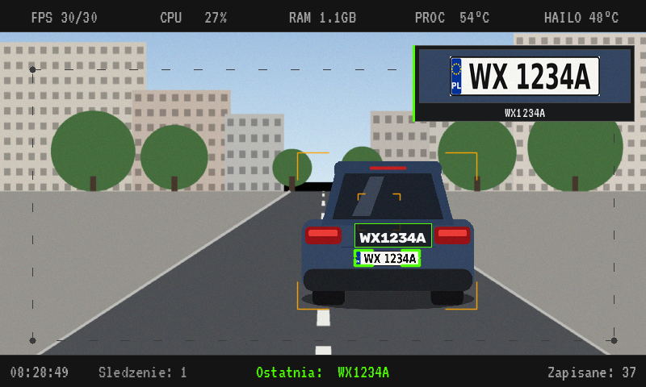
  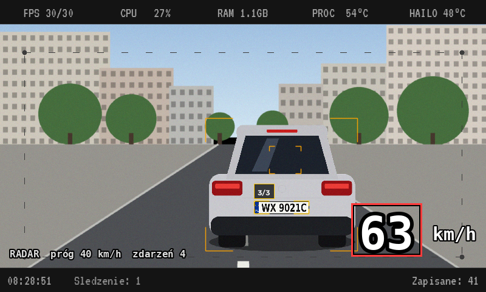
</p>
<p align="center"><sub>Ekran urządzenia w czasie jazdy i w trybie radaru: śledzone tablice, ostatnia potwierdzona tablica, bieżąca prędkość z radaru i statystyki systemu u góry.</sub></p>

<p align="center">
  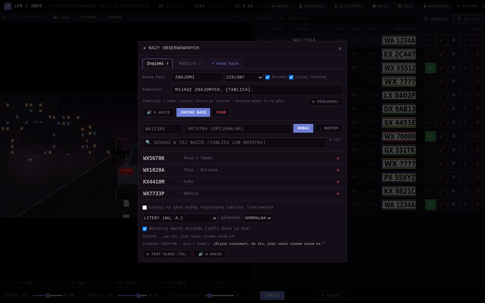
  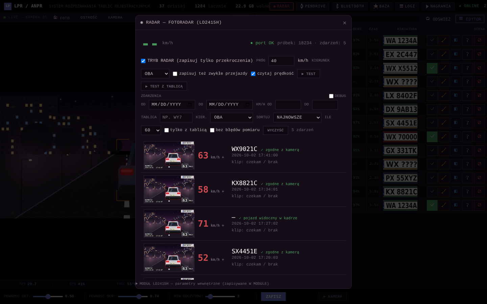
</p>
<p align="center"><sub>Edytor baz i lista zdarzeń radaru w panelu www. Panel serwuje samo urządzenie i można go zainstalować w telefonie jak aplikację.</sub></p>

## Sprzęt

| Element | Model | Do czego |
|---|---|---|
| Komputer | Raspberry Pi 5, 8 GB | wszystko |
| Akcelerator AI | Hailo-10H, M.2 | detekcja tablic i pojazdów, opcjonalnie OCR |
| Kamera | Arducam IMX708 HDR (B0310) z obiektywem 25 mm, CSI | 2304×1296 przy 30 fps, sprzętowy HDR |
| Radar | HLK-LD2415H, 24 GHz Doppler, UART | tylko prędkość, ±1 km/h, zasięg do ok. 180 m |
| Ekran | mały ekran dotykowy (domyślnie 800×480, faktyczny rozmiar czytany z DRM) | podgląd i menu kafelkowe |
| Dźwięk | wzmacniacz PAM8302 na wyjściu PWM malinki albo radio auta przez Bluetooth | komunikaty głosowe |
| Pamięć | pendrive USB | zdjęcia, baza, nagrania, kopie zapasowe |

Na początku projekt używał kamery USB Kurokesu C1 PRO. Ta ścieżka nadal istnieje i włącza się ją ustawieniem `"cam_source": "usb"`.

Uchwyty do druku 3D (malinka, kamera, moduł z przodu) są w [hardware/](hardware), w formatach 3MF i STL.

<p align="center">
  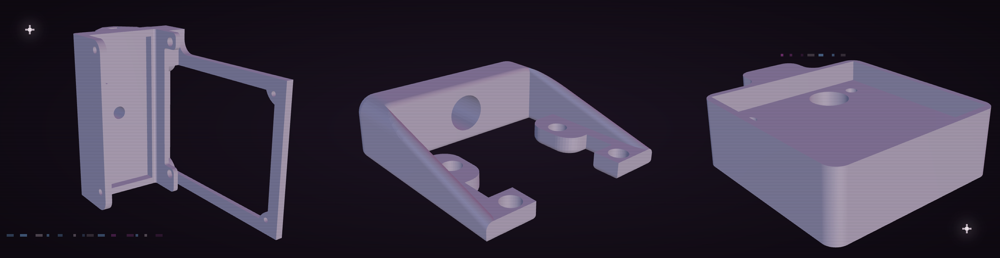
</p>

## Jak to działa

<p align="center">
  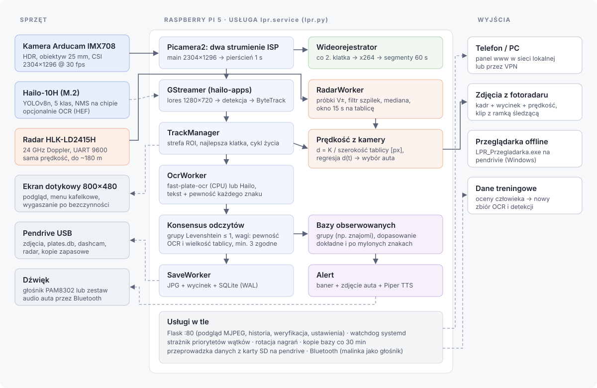
</p>

Cała aplikacja to jedna usługa użytkownika systemd, `lpr.service`, uruchamiana przez `lpr_run.sh`. Najważniejsze elementy, w kolejności, w jakiej spotyka je klatka:

1. **Dwa strumienie z jednego sensora.** Picamera2 prosi ISP o dwa wyjścia naraz. Pełna klatka 2304×1296 trafia do jednosekundowego pierścienia w RAM. Kopia 1280×720, skalowana sprzętowo, idzie do potoku GStreamera. Detekcja na mniejszym strumieniu nic mierzalnie nie traci (sprawdzone skryptem A/B na ramkach potwierdzonych przez człowieka), a wycinanie spadło z 18,8 ms do 0,8 ms na klatkę. Wycinki do OCR i zapisywane zdjęcia pochodzą z pełnej rozdzielczości, dobierane po numerze klatki.
2. **Detekcja i śledzenie** działają w potoku GStreamera z hailo-apps: `hailonet` z własnym plikiem HEF, potem `hailotracker`. Callback w Pythonie dostaje detekcje z każdej klatki.
3. **TrackManager** pilnuje stanu każdej tablicy w kadrze. Pomija detekcje spoza ustawionej strefy, odrzuca tablice ucięte krawędzią kadru, trzyma najlepszą klatkę (największa ramka razy pewność) i decyduje, kiedy track się kończy: 1,5 s bez detekcji albo 120 s łącznie przy długim postoju.
4. **OcrWorker** czyta wycinki w tle. Domyślnie to fast-plate-ocr (model CCT douczony na polskich tablicach) na jednym rdzeniu CPU. Jest też wariant na Hailo. HailoRT działa wtedy w osobnym procesie, bo część wywołań firmware trzyma GIL i zamrażała podgląd, gdy szła w głównym procesie. Kiedyś była też reguła, która wciskała odczyt w polski format tablicy. Na 1362 etykietach ludzkich psuła mniej więcej co dziesiąty prawdziwy numer, więc jest wyłączona: douczony model zna format sam, a każda ręczna reguła tylko mu szkodziła.
5. **Konsensus.** Odczyty grupowane są po odległości Levenshteina ≤ 1. Każdy głos ma wagę zależną od pewności OCR i wysokości wycinka, bo pomiar na 254 wycinkach pokazał, że odczyty przy 60–120 px są dobre w ok. 90%, a mniejsze i większe dużo rzadziej (ostrość okazała się bez znaczenia). Wcześniej trzy słabe odczyty z daleka potrafiły przegłosować dwa pewne z bliska. Tablica jest potwierdzona przy co najmniej trzech zgodnych odczytach, a po potwierdzeniu worker jeszcze przez chwilę dogrywa odczyty z bliska.
6. **SaveWorker** zapisuje pliki JPEG atomowo (plik tymczasowy, fsync, zmiana nazwy) i dopisuje przejazd do SQLite w trybie WAL, z deduplikacją w oknie 30 minut.

Wokół tego rdzenia jest kilka rzeczy, nad którymi spędziłem najwięcej czasu:

- **Priorytety wątków.** Koder wideorejestratora i potok rozpoznawania dzielą cztery rdzenie. Osobny wątek rozpoznaje wątki potoku po nazwach i trzyma je wyżej niż koder, żeby nagrywanie nigdy nie zagłodziło rozpoznawania.
- **Pomiar opóźnienia.** Każdy bufor dostaje stempel z numerem klatki, więc callback wie dokładnie, ile klatek utknęło w potoku. Tak udało się namierzyć konkretną kolejkę, kiedy w jednej jeździe zaległość urosła do 51 sekund.
- **Watchdog.** Pętla rysowania wysyła do systemd sygnał życia `WATCHDOG=1`, więc zamrożony ekran może zostać zrestartowany przez systemd (przy ustawionym `WatchdogSec`). Usługa wstaje po awarii, z limitem, który zatrzymuje pętlę restartów.
- **Błędy zostawiają ślad.** W aucie program musi działać dalej, więc wiele błędów jest łapanych. Każdy i tak trafia do logu przy pierwszym wystąpieniu i potem w podsumowaniu co pięć minut, bo kiedyś ciche `except: pass` ukrywało prawdziwy błąd przez dziesięć dni.
- **Dane.** Baza ma kopię co 30 minut, zdjęcia kopiują się przyrostowo. Pendrive można bezpiecznie wysunąć z menu. To, co zapisało się na kartę SD pod nieobecność pendrive'a, `scal_baze_sd.py` dokleja potem do bazy na pendrivie.

### Tryb fotoradaru

<p align="center">
  
</p>
<p align="center"><sub>Zdjęcie z fotoradaru w takiej postaci, w jakiej zapisuje je urządzenie: ramka pojazdu i tablicy, powiększony wycinek tablicy, numer, data, godzina i prędkość. Narysowane kodem projektu na syntetycznej scenie.</sub></p>

Radar zna prędkość, ale nie zna odległości, i widzi dużo dalej, niż da się przeczytać tablicę. Połączenie tych dwóch rzeczy to najciekawsza część.

- Radar wysyła linie w rodzaju `V+058.3`, do ok. 22 razy na sekundę. Zdarzenie otwierają trzy próbki powyżej progu.
- Moduły dopplerowskie dają szpilki harmoniczne, gdy echo słabnie (auto jadące 50 km/h na moment pokazuje 101). Próbka większa niż 1,5 raza i o ponad 20 km/h od mediany z ostatnich 0,6 s jest odrzucana. Prędkość zapisana w zdarzeniu to mediana pięciu najwyższych próbek, a nie szczyt.
- Gdy radar milknie na 1,5 s, zdarzenie się zamyka, a system czeka do 15 s na tablicę.
- Żeby nie przypisać prędkości złemu autu, każdy track dostaje też **prędkość policzoną z kamery**. Odległość jest odwrotnie proporcjonalna do szerokości tablicy w pikselach (d = K / px, K wynika z geometrii obiektywu i sensora), a regresja liniowa odległości w czasie daje km/h. Wygrywa kandydat, którego prędkość z kamery zgadza się z radarem. Gdy żaden się nie zgadza, zdarzenie zapisuje się z oznaczeniem „niepewne”.
- Wszystkie próbki radaru i każda para kamera/radar trafiają też do dziennych plików CSV, z których `analiza_kalibracji_radaru.py` koryguje stałą K.

<p align="center">
  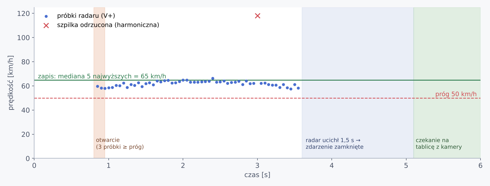
  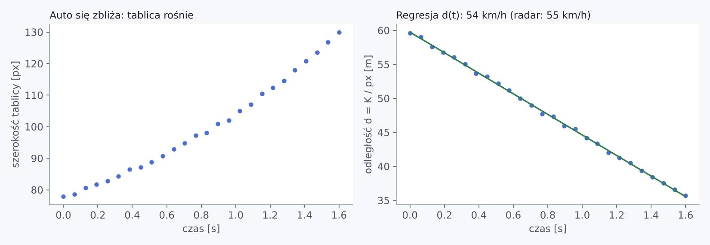
</p>
<p align="center"><sub>Dane symulowane: jak przetwarzane jest zdarzenie i jak z rosnącej tablicy liczy się prędkość.</sub></p>

## Liczby

Zmierzone na urządzeniu, o ile nie napisano inaczej.

| | |
|---|---|
| Kamera i detekcja | 30 fps, ok. 25% CPU i 1,1 GB RAM w normalnej pracy |
| Detektor na Hailo-10H | 234,6 fps w `hailortcli benchmark` |
| OCR na CPU (fast-plate-ocr CCT) | 213 z 254 tablic testowych bezbłędnie (83,9%) z pojedynczego odczytu, mediana 117 ms |
| OCR na Hailo (PaddleOCR rec, INT8) | 200 z 254 (78,7%), mediana 9,2 ms |
| Wideorejestrator | 1280×720, 15 fps, 4 Mb/s, ok. 30 MB na minutę |

Wyniki OCR dotyczą pojedynczego odczytu na stałym zbiorze 254 tablic z jednego dnia jazdy, trzymanym osobno od danych treningowych. W praktyce tablica czytana jest wiele razy i głosowanie jest dokładniejsze niż pojedynczy odczyt. Domyślny jest OCR na CPU, bo jest dokładniejszy. Doprowadzenie skwantyzowanego modelu na Hailo do dokładności z emulacji (81,5% w SDK, a na chipie dla najlepszego wariantu dużo mniej) to wciąż otwarty problem, opisany w [pi/local_resources/ocr/hailo_20261006](pi/local_resources/ocr/hailo_20261006) i [docs/ocr-hailo-wdrozenie.md](docs/ocr-hailo-wdrozenie.md).

## Struktura repozytorium

```
pi/                         wszystko, co działa na Raspberry Pi
  lpr.py                    aplikacja (potok, OCR, radar, wideorejestrator, interfejs, panel www)
  lpr_hailo_ocr.py          OCR na Hailo w procesie potomnym
  lpr_splash.py             animowany ekran startowy, osobny lekki proces
  lpr_run.sh, lpr.service   skrypt startowy i usługa systemd
  collect_plates.py         zbieranie danych treningowych do detekcji w czasie jazdy
  scal_baze_sd.py           scalanie bazy z karty SD z bazą na pendrivie
  sprawdz_zdrowie.sh        kontrola po wdrożeniu
  wgraj_na_malinke.sh       wdrożenie z PC przez SSH: kopia, kompilacja, commit na malince, restart, weryfikacja
  przegladarka_usb/         przeglądarka offline na Windows (budowana PyInstallerem na pendrive)
  narzedzia_testowe/        narzędzia testowe i diagnostyczne, w tym lokalna atrapa panelu www
training/                   budowa zbiorów z ocenionych odczytów, trening i ocena OCR
  hailo/                    skrypty kwantyzacji dla Hailo Dataflow Compiler
hardware/                   uchwyty do druku 3D
docs/                       obrazy, diagramy i notatki techniczne
```

## Uruchomienie

To działające, osobiste urządzenie, a nie gotowy produkt, więc postawienie go wymaga trochę pracy.

1. Zainstaluj oprogramowanie Hailo dla Raspberry Pi 5 i [hailo-apps](https://github.com/hailo-ai/hailo-apps) (wersja 26.x) w `/home/admin/hailo-apps`. PiLPR korzysta z jego klas potoku GStreamera.
2. Skopiuj zawartość `pi/` do tego katalogu, z podkatalogami.
3. Wgraj modele do `local_resources/`: HEF detektora (`lpr_yolov8n_v3`), model OCR `ocr/cct_s_v2_pl.onnx` z plikiem konfiguracji tablicy i opcjonalnie głos Piper `tts/pl_PL-gosia-medium.onnx`. Wytrenowanych wag nie ma w repozytorium, bo powstały na prywatnych nagraniach z jazd.
4. Zainstaluj usługę: `cp lpr.service ~/.config/systemd/user/ && systemctl --user enable --now lpr`.
5. Otwórz `http://<adres malinki>/` w telefonie w tej samej sieci.

Do radaru włącz `dtparam=uart0=on` i podłącz moduł do GPIO14/15. Ustawienia zmieniane w panelu www zapisują się w `local_resources/lpr_runtime_config.json`. Do wgrywania zmian z PC ustaw klucze SSH i uruchom `LPR_PI_SSH=admin@raspberrypi.local bash pi/wgraj_na_malinke.sh "opis"`.

Panel www nie ma logowania. Trzymaj go w zaufanej sieci albo za VPN-em.

## Prywatność i odpowiedzialne użycie

Numer rejestracyjny jest daną osobową w rozumieniu RODO, jeśli da się go powiązać z osobą, a to urządzenie zapisuje tablice, zdjęcia i czas. Jeśli budujesz swoje:

- trzymaj dane na urządzeniu, nie publikuj zdjęć ani numerów innych ludzi i usuwaj to, czego nie potrzebujesz,
- na listy wpisuj tylko osoby, które się na to zgodziły,
- w listach, które udostępniasz innym, umieszczaj wyłącznie pojazdy służbowe instytucji, nigdy prywatne auta konkretnych osób (także policjantów), bo to dane osobowe,
- tryb radaru traktuj jako pomiar ruchu na własnej ulicy, a nie jako egzekwowanie przepisów. Prywatny pomiar prędkości nie jest podstawą do mandatu, a wrzucanie do sieci zdjęć rozpoznawalnych kierowców samo w sobie może łamać prawo,
- sprawdź przepisy o nagrywaniu dróg publicznych i urządzeniach w samochodzie w swoim kraju.

W repozytorium nie ma nagrań, baz tablic ani wytrenowanych modeli, a numery w kodzie i na obrazach są zmyślone.

## Stan i pomysły

Urządzenie jeździ ze mną w aucie od kwietnia 2026. Co chciałbym zrobić dalej i gdzie pomoc się przyda:

- podzielić `lpr.py` (ok. 15 tys. linii) na moduły i wynieść HTML panelu www do osobnych plików,
- domknąć dokładność OCR na Hailo, żeby odciążyć procesor,
- zastąpić stałe i ścieżki `/home/admin` porządnym plikiem konfiguracyjnym,
- dopisać testy do konsensusu, formatu tablic i logiki zdarzeń radaru, bo to czyste funkcje i łatwo je pokryć,
- osobna, stacjonarna wersja trybu radaru do pomiaru ruchu na osiedlowej ulicy.

Jeśli chcesz zbudować własne, przerobić je albo pogadać o projekcie, załóż issue.
